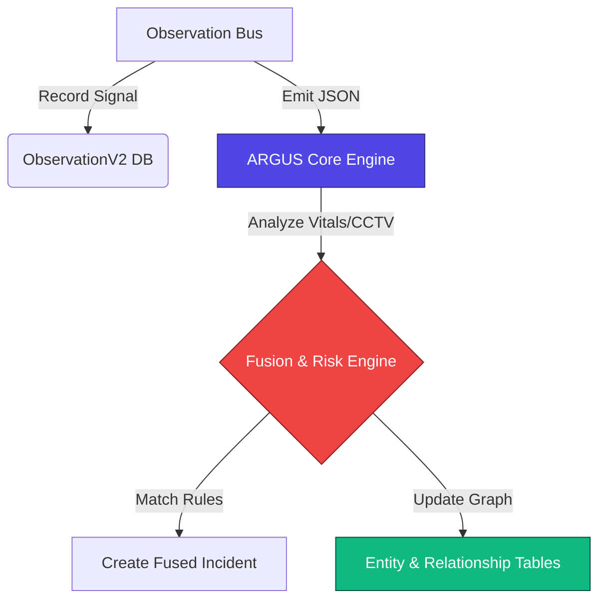

# InteracAI Industry Module Architecture & ARGUS Intelligence Audit Report

**Author:** Antigravity AI Engineering Team  
**Date:** August 6, 2026  
**Status:** Completed Architecture Audit  
**Workspace:** VictorSylva/interac-ai  
**Target Modules:** Hotels & Hospitality, Healthcare & Hospital, Retail & Supermarket, School / Education  

---

## Executive Summary

This architecture audit establishes a precise engineering baseline for the existing Industry Modules implemented within InteracAI. The audit evaluates the modules' use of the platform's core services, including the **Dynamic Entity System (EAV-JSON Hybrid)**, the **Observation Bus**, and integration with the **ARGUS OS Core Intelligence Engine**. 

### Core Architectural Findings

1. **EAV-JSON Dynamic Entity System:** All inspected modules rely entirely on the dynamic `EntityType` and `EntityV2` models rather than traditional physical SQL tables. This enables high modularity and zero-migration schema updates, but incurs performance and query-complexity overhead at enterprise scale.
2. **Observation Ingestion and Signal Flow:** Signal processing is implemented via REST routers that record observations in the local database (`ObservationV2`) and emit them to the central `ARGUS Core` service.
3. **ARGUS Graph Compilation Gaps:** Graph edge relationships are compiled dynamically in `ObservationService.form_argus_relationships` during observation ingestion. However, **only the Hotels and Hospital modules have graph relationship mappings implemented.** The Retail and Education modules lack relationship-mapping code entirely, preventing them from building a queryable knowledge graph in the ARGUS Core.
4. **Mocked AI and Integrations:** While the backend manifests list a large number of AI Copilot skills and integrations (e.g., FHIR, HL7, POS, Mews, Opera), their actual handlers are simulated, returning static mock structures or heuristic rule-based responses rather than executing live machine learning models or hardware protocols.
5. **Critical Syntax Bug:** In `education_routes.py`, surveillance signals are sent using the argument `risk_score_impact`, which does not exist in `ObservationService.record_observation` (which expects `risk_impact`). This triggers runtime errors during mock security alert generation.

---

## 1. Hotels & Hospitality Module (`module_hotels`)

### Section 1: Current Functional Scope
* **Reservations Management:** View, list, and create reservations. 
* **Front Desk State Machine:** Automated guest check-in and check-out workflows, mapping check-in events to room occupancy changes.
* **Folio Billing & Settlement:** Invoicing, posting minibar or restaurant charges to room folios, settle balances, and payment verification.
* **Housekeeping Schedule:** Creating and updating room cleaning tasks (Pending ➔ Cleaning ➔ Completed ➔ Inspected).
* **Maintenance Logs:** Fault ticket registration, automatically blocking rooms to "Out of Service" state, and resolving tickets to return rooms to "Vacant".
* **Restaurant POS:** Posting tables orders, charging directly to checking-in rooms or direct payment.
* **Inventory SKUs:** Product SKU creation, stock count adjustments, and warning indicators for low stock.
* **Finance Analytics:** Dynamic generation of Hotel KPIs (Average Daily Rate [ADR], Revenue Per Available Room [RevPAR], occupancy rates).
* **External Integration Simulators:** Simulated confirmation email parsing, CSV batch import, and Mews/Opera webhook receivers.

### Section 2: Current Database Entities
All entities are instantiated as `EntityV2` instances linked to dynamically resolved `EntityType` definitions:
* `hotel_guest`: Guest profiles containing VIP status, nationality, passport ID, and stay preferences.
* `hotel_room`: Hotel rooms tracking room type, floor level, occupancy status (`VACANT`, `OCCUPIED`, `OUT_OF_SERVICE`), nightly rate, and housekeeping state (`Clean`, `Dirty`, `Cleaning`).
* `hotel_reservation`: Stay details linking guest and room IDs, booking source, arrival/departure dates, and reservation status (`RESERVED`, `CHECKED_IN`, `CHECKED_OUT`).
* `keycard_log`: Track keycard door entry events, storing room number, timestamp, and status.
* `housekeeping_task`: Cleaning assignments tracking room numbers, assigned cleaner, status, priority, and notes.
* `maintenance_ticket`: Maintenance requests detailing room number, problem description, technician assigned, priority, and status.
* `restaurant_order`: Food/beverage bills tracking table numbers, itemized rows, total amounts, and status.
* `restaurant_food`: Inventory items representing restaurant menu choices.
* `hotel_inventory`: Hotel supply SKUs tracking stock levels, alert thresholds, supplier, and unit cost.
* `hotel_invoice`: Guest ledger (folios) tracking charges list, payments list, outstanding balances, and status (`OPEN`, `SETTLED`, `CLOSED`).

### Section 3: Current Department Structure
Permissions and roles are mapped to specific departments:
* **Departments with Active Dashboards/Sidebar Routes:** `frontdesk`, `reception`, `housekeeping`, `maintenance`, `restaurant`, `kitchen`, `bar`, `accounts`, `finance`, `store`, `general_manager`, `owner`.
* **Departments Missing dedicated Workspaces:** `laundry`, `hr`, `marketing`, `it`, `security` (their roles exist in permissions but they lack dedicated page designs; they reuse basic sidebar routes).

### Section 4: Current Role-Based Access
* **Roles Defined:** Owner, Admin, General Manager, Frontdesk Staff, Receptionist, Housekeeper, Maintenance Tech, Accountant, Cashier, Viewer.
* **RBAC Implementation:** Implemented in `auth_service.py` using `DEFAULT_ROLE_PERMISSIONS`. If a user does not have an explicit permission (e.g., `hotel.reservations.create`), the router raises `403 Forbidden`. The frontend sidebar (`DashboardLayout.js`) filters navigation links using path-to-department maps (e.g., `/hotels/housekeeping` is hidden from the `restaurant` department).

### Section 5: Current Workflows
* **Triggered Workflows:**
  * `reservation_booked`: Triggered upon creating a reservation.
  * `guest_checkin`: Triggered on check-in, creating guest folio in database.
  * `guest_checkout`: Triggered on check-out, flagging room as dirty.
  * `maintenance_reported`: Triggered on logging a fault, setting room status to `OUT_OF_SERVICE`.

### Section 6: Signals Generated
* **Guest Check-in:** Frontdesk Check-in ➔ `guest_checkin` Observation ➔ ARGUS OS.
* **Guest Check-out:** Frontdesk Check-out ➔ `guest_checkout` Observation ➔ ARGUS OS.
* **Folio Payment Reconciled:** Account Payment ➔ `folio_payment` Observation ➔ ARGUS OS.
* **Maintenance Reported:** Maintenance Desk ➔ `maintenance_reported` Observation (Warning) ➔ ARGUS OS.
* **POS Room Charge:** Restaurant POS ➔ `pos_room_charge` Observation ➔ ARGUS OS.
* **POS Direct Payment:** Restaurant POS ➔ `pos_direct_payment` Observation ➔ ARGUS OS.
* **Low Stock warning:** Store room ➔ `low_stock_warning` Observation ➔ ARGUS OS.
* **Webhook/Batch Ingestion:** External connector ➔ `connector_signal_received`/`connector_csv_imported`/`connector_email_parsed` ➔ ARGUS OS.

### Section 7: ARGUS Intelligence Integration
* **Observations Transmitted:** Standardized JSON signals containing source, entity ID, location, severity, and attributes.
* **Observation Types:** `guest_checkin`, `guest_checkout`, `folio_payment`, `maintenance_reported`, `pos_room_charge`, `pos_direct_payment`, `low_stock_warning`, `connector_signal_received`.
* **Entity Relationships formed (`form_argus_relationships`):**
  * `hotel_guest` ➔ `HAS_RESERVATION` ➔ `hotel_reservation`
  * `hotel_reservation` ➔ `ASSIGNED_ROOM` ➔ `hotel_room`
  * `keycard_log` ➔ `ACCESS_EVENT_AT` ➔ `hotel_room`
  * `restaurant_order` ➔ `CHARGED_TO_FOLIO` ➔ `hotel_invoice`
* **Events Triggering Intelligence:** Failed keycard entries, vacant room access.
* **AI Copilot Skills:** 
  * `module_hotels:analyze_room_occupancy_anomalies`: Cross-references vacant room lists with keycard entries.
  * `module_hotels:generate_vip_guest_service_report`: Compiles stay timeline and profile preference cards for VIPs.
  * `module_hotels:detect_unauthorized_room_access`: Scans logs for card swipe failures.
* **Generated Intelligence:** Active room occupancy rate, keycard radar maps, VIP dossier warnings.
* **Intelligence NOT Generated:** Predictive room cleaning schedules, RevPAR forecasting, seasonal rate optimization.

### Section 8: Cross-Department Intelligence
* **Current Status:** Departments interact solely through state updates to the dynamic database entities (e.g., Front Desk check-out updates the Room attributes, which changes the room housekeeping status to "Dirty", reflecting on the housekeeping clean list).
* **Missing Features:** Real-time push alerts, messaging systems between front-desk and housekeeping, and automated security dispatches for unauthorized swipes.

### Section 9: Dashboard Intelligence
* **Occupancy Rate Widget:** Static UI widget displays "84%" (hardcoded mock in module manifest, not querying database).
* **Keycard Radar Widget:** Static radar chart component (empty config, no live database binding).
* **Finance Widget:** Analytics endpoint aggregates EAV folio data.

### Section 10: AI Copilot Capabilities
* `analyze_room_occupancy_anomalies`: Runs queries on `keycard_log` and `hotel_room` vacant status.
  * **Limitations:** Relies on manual mock entries in `keycard_log`. Hallway CCTV foot traffic is a mock attribute (no actual image recognition).
* `generate_vip_guest_service_report`: Summarizes VIP guest profiles and active booking statuses.
  * **Limitations:** Limited to database string matches (`vip_status != 'Regular'`).
* `detect_unauthorized_room_access`: Retrieves door lock logs and filters by `DENIED` status.
  * **Limitations:** Pure database check on static mock EAV table logs.

### Section 11: Entity Relationships
Relationships are constructed dynamically in `observation_service.py` using foreign-key-style mappings in the JSON attributes (e.g., `guest_id` in the reservation JSON resolves back to the guest profile).

### Section 12: External Integrations
* **Mews / Opera Webhooks:** Mocked (JSON REST receiver converts fields into EAV entities).
* **CSV Importer:** Mocked (parses columns, batch inserts `EntityV2` instances).
* **Email Confirmation Parser:** Mocked (regular expression extraction from body strings).
* **Door Lock Controllers:** Missing (no physical lock integration).
* **CCTV Feeds:** Missing (simulated via CCTV alerts).

### Section 13: Enterprise Readiness Assessment
* Feature Completeness: **4/10** (Lacks guest ledger auditing, room configuration rules, tax compliance, and fiscal receipt printing).
* Department Completeness: **5/10** (HR, IT, Laundry lack dashboards).
* Workflow Completeness: **4/10** (Workflows are triggered, but have no multi-level escalations).
* Signal Completeness: **3/10** (Lacks live hardware signals).
* ARGUS Integration: **6/10** (Relationships mapped in code, but ARGUS OS lacks hospitality threat rules).
* Analytics: **5/10** (ADR/RevPAR are calculated on the fly, but lack historical cohort charts).
* AI Reasoning: **3/10** (Copilot skills are mock-based checks).
* RBAC: **7/10** (Granular permissions mapped, but frontend filtering is hardcoded).
* Enterprise Readiness: **4/10**
* **Overall Score: 4.6 / 10**

### Section 14: Missing Components
* **Missing Workflows:** Dynamic room pricing, auto-dispatch housekeeping alerts, VIP arrival SMS notifications, automated night audit reconciliation.
* **Missing Entities:** Folio split ledger items, tax detail entries, guest history files.
* **Missing Integrations:** Fiscal printer interfaces, payment gateways, live door keycard encrypters, Wi-Fi gateway controllers.
* **Missing Security:** Lock audit logs, restricted hour alerts.

### Section 15: Industry Standard Comparison
Compared to **Oracle OPERA** and **Mews**, InteracAI's hospitality module functions as an operational prototype. It lacks dual-entry folio ledger splits, regional tax calculation nodes, room allotment blocks for corporate bookings, and direct card terminal handshakes.

---

## 2. Healthcare & Hospital Module (`module_hospital`)

### Section 1: Current Functional Scope
* **Patient Records (SIS/HIS):** Patient profile builder, photo capture, and medical history database.
* **Clinical EMR Workspace:** Logging consultations, vitals, diagnoses, prescriptions, and lab/radiology request forms.
* **Nurse Checklists:** Nurse station log sheets to track rounds, vitals tracking, and clinical notes.
* **Pharmacy Dispensation:** Medicine inventory logs, stock level warning indicators, controlled drug dispensing authorization, and weekly pharmacy demand forecasts.
* **Lab & Radiology Diagnostics:** Diagnostic order creation, status transitions (Sample Pending ➔ Analyzing ➔ Completed), PACS URL storage, and critical lab value warnings.
* **Billing Desk:** Reconciling medical bills, payment settlements, and insurance co-pay calculations.
* **Ward Management:** Bed allocation dashboard, separating ICU beds from general ward beds.
* **Emergency Department (ER):** Triage category dashboard (Critical, Emergency, Urgent, Normal) and waiting time metrics.
* **Surgical Theatre:** Operating room calendars, surgical team logs, and equipment precheck checks.
* **Ambulance Dispatch:** Standby ambulance tracking, GPS coordinates simulation, and dispatch alerts.
* **Sync Connectors:** Parsing HL7 v2 PID segments, and FHIR Patient/Observation JSON resource parsers.

### Section 2: Current Database Entities
* `hospital_patient`: Patient profiles containing triage levels, allergies, medical history, and emergency contact.
* `hospital_appointment`: Clinical schedules linking patient and doctor IDs, department, and visit type.
* `hospital_emr`: Clinical records containing vitals, diagnoses, notes, prescriptions, and radiology requests.
* `hospital_nursing_log`: Shift checklist entries containing nursing actions and ward observations.
* `hospital_medicine`: Pharmacy stock tracking quantities, alert thresholds, controlled substance flag, and supplier details.
* `hospital_lab_test`: Laboratory test orders tracking status, results, and critical alert tags.
* `hospital_radiology_scan`: Scans tracking imaging type, DICOM URLs, and radiologist reports.
* `hospital_invoice`: Patient balance sheets tracking invoice ID, charges list, insurance co-pay, and payment status.
* `hospital_insurance_claim`: Policy records containing claim ID, provider, pre-auth codes, and status.
* `hospital_bed`: Bed allocations tracking bed number, ward type (ICU/General), and occupant status.
* `hospital_theatre_schedule`: Surgery logs tracking surgical procedures, surgeons, scheduled times, and equipment checks.
* `hospital_inventory_item`: General medical inventory SKUs.
* `hospital_procurement_request`: Medicine replenishment requests.
* `hospital_staff`: Staff member records tracking licenses, active duty shifts, and roles.
* `hospital_maintenance_schedule`: Medical asset maintenance logs.
* `hospital_ambulance`: Emergency vehicles tracking license plate numbers, status, and driver assignments.

### Section 3: Current Department Structure
* **Departments with Active Dashboards:** `reception`, `doctors`, `nurses`, `laboratory`, `radiology`, `pharmacy`, `finance`, `ward` (wards/beds), `emergency`, `theatre` (surgical), `icu`, `hr`, `maintenance`, `ambulance`, `administration`, `management`.
* **Missing workspaces:** All listed departments have basic route mappings, but their screens are heavily consolidated and lack distinct workspace layouts.

### Section 4: Current Role-Based Access
* **Roles Defined:** Owner, Admin, Reception Staff, Doctor, Nurse, Lab Tech, Radiologist, Pharmacist, Finance Officer, HR Manager, Maintenance Worker, ICU Specialist, ER Triage Nurse, Hospital Administrator.
* **RBAC Implementation:** Mapped in `auth_service.py` defaults. Doctors are granted extensive permissions (EMR write, prescriptions write), whereas Receptionists are restricted to patient registration and appointments. 

### Section 5: Current Workflows
* **Triggered Workflows:**
  * `appointment_booked`: Sends scheduling notifications to patients.
* **Missing Workflows:** Patient admission to ward bed, pharmacy stock alerts, lab value alerts, insurance claims processing.

### Section 6: Signals Generated
* **Patient Checked-in:** Reception ➔ `patient_checkin` Observation ➔ ARGUS OS.
* **Appointment Created:** Booking Desk ➔ `appointment_booked` Observation ➔ ARGUS OS.
* **Doctor Consultation Logged:** Doctor EMR ➔ `doctor_consultation` Observation ➔ ARGUS OS.
* **Critical Vitals Recorded:** Doctor/Nurse Workspace ➔ `vitals_changed` Observation (Critical) ➔ ARGUS OS.
* **Medicine Dispensed:** Pharmacy Desk ➔ `medicine_dispensed` Observation ➔ ARGUS OS.
* **Low Drug Stock:** Pharmacy Inventory ➔ `medicine_shortage_alert` Observation (Warning) ➔ ARGUS OS.
* **Lab completed:** Diagnostics ➔ `lab_completed` Observation (Critical if `is_critical` is true) ➔ ARGUS OS.
* **Insurance Claim Approved:** Billing ➔ `insurance_approved` Observation ➔ ARGUS OS.
* **Bed allocated/released:** Ward Desk ➔ `bed_occupied`/`patient_discharged` Observation ➔ ARGUS OS.
* **Ambulance Dispatched:** Dispatch desk ➔ `ambulance_dispatched` Observation ➔ ARGUS OS.
* **FHIR/HL7 sync:** FHIR/HL7 API ➔ `patient_checkin`/`vitals_changed` Observation ➔ ARGUS OS.
* **Patient Fall / Incident:** Security Cameras ➔ `patient_fall` / `violence_detection` Observation (Critical) ➔ ARGUS OS.

### Section 7: ARGUS Intelligence Integration
* **Observations Transmitted:** High-volume signals across reception, clinical vitals, pharmacy stock, lab results, and CV cameras.
* **Entity Relationships formed:**
  * `hospital_patient` ➔ `HAS_APPOINTMENT` ➔ `hospital_appointment`
  * `hospital_patient` ➔ `HAS_EMR` ➔ `hospital_emr`
  * `hospital_appointment` ➔ `ASSIGNED_DOCTOR` ➔ `hospital_staff` (Doctor)
  * `hospital_emr` ➔ `EMR_OF_PATIENT` ➔ `hospital_patient`
  * `hospital_emr` ➔ `WRITTEN_BY_DOCTOR` ➔ `hospital_staff` (Doctor)
  * `hospital_invoice` ➔ `BILL_TO_PATIENT` ➔ `hospital_patient`
  * `hospital_bed` ➔ `OCCUPIED_BY_PATIENT` ➔ `hospital_patient`
  * `hospital_ambulance` ➔ `DISPATCHED_FOR_PATIENT` ➔ `hospital_patient`
* **Risk Rules Implemented:**
  * `er_triage_wait_time_over_45_mins` (risk weight 0.85)
  * `unauthorized_pharmacy_inventory_entry` (risk weight 0.95)
  * `patient_critical_vitals_not_reviewed` (risk weight 0.90)
* **AI Copilot Skills:** 16 skills are registered.
* **Generated Intelligence:** Waiting times, ER congestion forecasts, ICU bed occupancy, EMR summaries, shift handovers.
* **Intelligence NOT Generated:** Clinical drug interaction validation, patient readmission warnings, automated staff scheduling.

### Section 8: Cross-Department Intelligence
* **Current Status:** Basic database state syncing (e.g., Doctor orders a lab test in the EMR, which populates the Lab test EAV table).
* **Missing Features:** Real-time push notifications. For instance, when a lab test is completed with critical values, the ordering physician is not alerted directly; they must manually check the lab registry.

### Section 9: Dashboard Intelligence
* **ER Wait Time Widget:** Static metric widget shows "14m" (hardcoded config).
* **Bed Capacity Widget:** Static chart widget shows "78%" (hardcoded config).
* **Revenue Widget:** Static metric widget displays "₦4.8M" (hardcoded config).
* **ICU Alerts Widget:** Static alert widget shows "0 Active".

### Section 10: AI Copilot Capabilities
* **Clinical Skills (ICU demand, ER congestion, waiting times, readmission risk):** Returns mock JSON payloads containing static predictions (e.g., ICU demand: "Ventilators active: 8/10", readmission risk: "74%").
* **EMR Summarizer:** Extracts text from EMR record attributes and formats a narrative summary.
  * **Limitations:** No actual clinical model is run. Prescriptions are not checked for contraindications.

### Section 11: Entity Relationships
Entity relationships are structured in `observation_service.py` and visualized in the frontend via a node-edge graph generated by querying patients, appointments, and beds.

### Section 12: External Integrations
* **FHIR Ingestion:** Mocked (fastapi route parses basic JSON payload).
* **HL7 parser:** Mocked (split-based string parsing of HL7 pipe messages).
* **Ambulance Tracking:** Mocked (simulates GPS coordinates).
* **PACS / DICOM Image viewer:** Mocked (displays static image URL placeholder).
* **Patient Monitors / ICU Vitals hardware:** Missing.

### Section 13: Enterprise Readiness Assessment
* Feature Completeness: **5/10** (EMR is present, but lacks prescription templates, ICD-10 codings, and clinical auditing).
* Department Completeness: **7/10** (Wide coverage of roles, but interfaces are simplified).
* Workflow Completeness: **3/10** (Only one route triggers a workflow).
* Signal Completeness: **3/10** (Vitals signals are mock data).
* ARGUS Integration: **7/10** (Comprehensive relationship map and risk rules).
* Analytics: **4/10** (Aggregates revenue and bed counts, but lacks cohort tracking).
* AI Reasoning: **3/10** (Copilot skills are mock-based checks).
* RBAC: **8/10** (Well-structured department maps).
* Enterprise Readiness: **4/10**
* **Overall Score: 4.8 / 10**

### Section 14: Missing Components
* **Missing Workflows:** Doctor e-prescribing, lab specimen tracking, clinical triage alerts.
* **Missing Entities:** ICD-10/ICD-11 codes, drug-drug interaction records.
* **Missing Integrations:** Real DICOM servers, medical device connections.
* **Missing Compliance:** HIPAA audit logging.

### Section 15: Industry Standard Comparison
Compared to **Epic Systems** or **Cerner**, InteracAI lacks clinical decision support, HIPAA-compliant access logs, dynamic order-set workflows, and direct medical device connections.

---

## 3. Retail & Supermarket Module (`module_retail`)

### Section 1: Current Functional Scope
* **Stores Directory:** Branch metadata tracking (manager, zones, hours).
* **Product Catalog:** Product Variant SKU catalog management (selling price, unit cost, barcode, category).
* **Inventory & Warehousing:** Stock levels, reorder thresholds, and warehouse allocations.
* **POS Checkout Sales:** Completing sales transactions, logging lane details, payment methods, and cashier voids.
* **Customer Loyalty (CRM):** Loyalty profile tracking (membership tier, points, churn risk).
* **Procurement & Supplier Scorecards:** Supplier profiles, lead times, and scorecard ratings.
* **Finance Margins:** Daily revenue calculations, profit margins, and category-level sales shares.
* **HR Shift Registry:** Employee shift logs, punch cards (Clock-in / Clock-out).
* **Equipment Maintenance:** Maintenance jobs for assets (refrigerators, card terminals).
* **E-Commerce Sync Logs:** Shopify and WooCommerce catalog sync logs.
* **CCTV Surveillance Alerts:** CCTV security events list (shoplifting, sweet-hearting).

### Section 2: Current Database Entities
* `branch_store`: Store location, manager, list of zones, and refrigerator temperature values.
* `product`: Product SKUs containing selling price, unit cost, barcode, and digital catalog visibility.
* `supplier`: Vendor profiles containing contact details, lead times, quality scores, and scorecard ratings.
* `pos_terminal`: Cash registers.
* `shelf`: Aisle definitions.
* `warehouse`: Depots tracking stock locations.
* `purchase_order`: Procurement records.
* `promotion`: Discount campaigns.
* `customer_loyalty`: Customer loyalty logs containing membership tier and points.
* `employee_shift`: Shift logs tracking cashier clock-in/out times.
* `maintenance_job`: Repairs log tracking repair tickets.

### Section 3: Current Department Structure
* **Departments with Active Dashboards/Sidebar routes:** `regional_manager`, `branch_manager`, `operations_manager`, `store_supervisor`, `cashier`, `customer_service`, `inventory_manager`, `warehouse_staff`, `receiving_team`, `procurement`, `finance`, `marketing`, `hr`, `security`, `maintenance`, `delivery`.
* **Missing workspaces:** Online orders, store owners lack dedicated layouts.

### Section 4: Current Role-Based Access
* **Roles Defined:** Store Owner, Regional Manager, Branch Manager, Operations Manager, Store Supervisor, Cashier, Customer Service Rep, Inventory Manager, Warehouse Staff, Receiving Team, Procurement Agent, Finance Admin, Marketing Specialist, HR Administrator, Security Officer, Maintenance Tech, Delivery Driver.
* **RBAC Implementation:** Permissions are mapped in `auth_service.py` defaults. Cashiers are restricted to POS sales write, whereas Branch Managers have access to inventory and billing.

### Section 5: Current Workflows
* **Triggered Workflows:** **None.** The retail routes file (`retail_routes.py`) does not import or trigger the workflow engine.

### Section 6: Signals Generated
* **Product Created:** Catalog ➔ `price_changed` Observation ➔ ARGUS OS.
* **Inventory Adjusted:** Warehouse ➔ `inventory_adjusted` Observation ➔ ARGUS OS.
* **POS Sale Completed:** Checkout ➔ `sale_completed` Observation ➔ ARGUS OS.
* **CCTV Shoplifting/Sweet-hearting:** AI Cameras ➔ `cctv_sweethearting_detected` Observation (Critical) ➔ ARGUS OS.
* **Employee Punch in/out:** HR Terminal ➔ `employee_clocked_in` / `employee_clocked_out` Observation ➔ ARGUS OS.

### Section 7: ARGUS Intelligence Integration
* **Observations Transmitted:** Sales transactions, stock adjustments, and CCTV surveillance logs.
* **Observation Types:** `price_changed`, `inventory_adjusted`, `sale_completed`, `cctv_sweethearting_detected`, `employee_clocked_in`, `employee_clocked_out`.
* **Entity Relationships formed:** **None.** The function `form_argus_relationships` in `observation_service.py` lacks retail-specific mappings.
* **Risk Rules Implemented:**
  * `cctv_sweethearting_detected` (risk weight 0.90)
  * `cctv_shoplifting_detected` (risk weight 0.95)
  * `restricted_area_intrusion` (risk weight 0.80)
  * `refrigerator_temp_anomaly` (risk weight 0.75)
  * `cash_variance_alert` (risk weight 0.70)
  * `after_hours_intrusion` (risk weight 0.99)
* **AI Copilot Skills:** 18 skills are registered.
* **Generated Intelligence:** Stock shortages, demand forecasting, discount recommendations, void flags, cashier theft analysis.
* **Intelligence NOT Generated:** Multi-item bundle affinity analysis, dynamic pricing based on stock levels.

### Section 8: Cross-Department Intelligence
* **Current Status:** No cross-department alerts are supported in code. For example, a refrigerator temp anomaly does not trigger a maintenance ticket automatically.

### Section 9: Dashboard Intelligence
* **Sales Today Widget:** Displays static text: "₦1,850,200".
* **Shrinkage Rate Widget:** Displays static text: "1.25%".
* **Out of Stock Widget:** Displays static text: "4 SKUs Critical".
* **Security Alerts Feed:** Displays recent CCTV log entries.

### Section 10: AI Copilot Capabilities
* **AI Predictive Skills (stock shortages, demand, optimization):** Returns mock dictionaries containing static responses.
* **Loss Prevention Analyzer:** Identifies shrinkages by matching transaction counts with inventory levels.
  * **Limitations:** Heuristics run on local mock variables.

### Section 11: Entity Relationships
No active database relationships are stored or mapped for Retail.

### Section 12: External Integrations
* **Shopify / WooCommerce sync:** Mocked (static log entries).
* **POS Scanners:** Mocked (barcode matching using string filters).
* **RFID / Security gates:** Missing.
* **IoT Refrigerator Temp Sensors:** Missing (simulated via simulated alerts).

### Section 13: Enterprise Readiness Assessment
* Feature Completeness: **4/10** (POS lacks receipt printer integrations, card readers, and offline buffering).
* Department Completeness: **5/10** (Lack of dedicated layouts for Cashiers or Warehouse Staff).
* Workflow Completeness: **0/10** (No workflows are triggered from POS or inventory changes).
* Signal Completeness: **3/10** (Surveillance alerts are simulated).
* ARGUS Integration: **3/10** (No graph relationships are defined in the observation service).
* Analytics: **4/10** (Static charts on the dashboard).
* AI Reasoning: **2/10** (Copilot skills return hardcoded data).
* RBAC: **7/10** (Mapped in defaults, but lacks cashier drawer-lock controls).
* Enterprise Readiness: **3/10**
* **Overall Score: 3.4 / 10**

### Section 14: Missing Components
* **Missing Workflows:** Auto-replenishment workflows, real-time price markdown triggers.
* **Missing Integrations:** ESC/POS receipt printer drivers, payment terminals (Visa/Mastercard), RFID barcode scanners.

### Section 15: Industry Standard Comparison
Compared to **Lightspeed POS** or **Shopify POS**, InteracAI lacks offline POS checkout capabilities, hardware integrations, multi-terminal cash register sessions, and tax calculation settings.

---

## 4. School & Education Module (`module_education`)

### Section 1: Current Functional Scope
* **Student Directory (SIS):** Student profile builder, parent contact details, and onboarding workflows.
* **Admissions Desk:** Admission applications logging, entrance exam score records, and application status tracking.
* **Academic Course registry:** Class streams, subject catalogs, and teacher assignments.
* **Attendance Tracking:** Check-in logs using biometrics/RFID or manual registers.
* **Learning (LMS):** Assignment assignments, study material uploads, and grading records.
* **Exams & CBT:** Virtual computer-based test (CBT) scheduling, questions database, and test score submissions.
* **Library Management:** Catalog index, availability levels, and book borrowing/returning logs.
* **Fees & Finance:** Fee invoice creation, scholarship discounts, and Paystack integration simulators.
* **Staff & HR Registry:** Teacher attendance registry and lesson scheduling checklists.
* **Asset Inventory:** Classroom inventory SKU tracking.
* **School Bus Transport:** Bus route tracking and simulated GPS tracking.
* **Clinic logs:** Clinic visit registration, symptoms recording, and parental notifications.
* **Cafeteria POS:** Student purchase logging.
* **Security & CCTV Surveillance:** Campus loitering alerts and fight detection.

### Section 2: Current Database Entities
* `student_record`: Student profiles tracking Matric ID, guardian name/email, attendance risks, and grades.
* `education_admission`: Admission application details.
* `education_calendar`: Campus scheduling logs.
* `education_teacher`: Teacher profiles tracking subject categories and workload hours.
* `education_attendance`: Attendance entries tracking check-in time and check-in methods.
* `education_course`: Course modules.
* `education_assignment`: Study material links.
* `education_exam`: Exam details and question databases.
* `education_library`: Book inventory tracking borrow logs and availability.
* `education_invoice`: Fee records tracking totals, discounts, and payment transactions.
* `education_staff`: General campus staff records.
* `education_inventory`: Campus property items.
* `education_transport`: Bus route coordinates.
* `education_hostel`: Room bookings tracking occupants and capacity.
* `education_clinic`: Health records tracking clinic visits, symptoms, and medication details.
* `education_cafeteria`: Cafeteria purchase logs.
* `education_security_alert`: CCTV anomaly observations.
* `education_campus`: Multi-campus details.

### Section 3: Current Department Structure
* **Departments with Active Dashboards/Sidebar routes:** `principal`, `vice_principal`, `registrar`, `admissions`, `academic_office`, `teachers`, `class_teachers`, `parents`, `students`, `library`, `ict`, `transport`, `hostel`, `clinic`, `finance`, `accounts`, `hr`, `maintenance`, `security`.
* **Missing workspaces:** None, but many workspaces share identical layouts.

### Section 4: Current Role-Based Access
* **Roles Defined:** Principal, Vice Principal, Registrar, Admissions Coordinator, Academic Officer, Teacher, Class Teacher, Parent, Student, Librarian, ICT Administrator, Transport Officer, Hostel Warden, Clinic Nurse, Security Officer, Finance Manager, Accountant, HR Manager, Maintenance Worker.
* **RBAC Implementation:** Mapped in `auth_service.py` defaults. Parents and students are locked to their respective portal routes.

### Section 5: Current Workflows
* **Triggered Workflows:** **None.** The education routes file (`education_routes.py`) does not trigger the workflow engine.

### Section 6: Signals Generated
* **Student Onboarded:** Academic Office ➔ `student_onboarded` Observation ➔ ARGUS OS.
* **Admission Logged:** Admissions Desk ➔ `admission_application` Observation ➔ ARGUS OS.
* **Admission Approved:** Admissions Desk ➔ `admission_approved` Observation ➔ ARGUS OS.
* **Attendance checkin:** Gate Biometrics ➔ `attendance_checkin` Observation ➔ ARGUS OS.
* **Exam Published:** Academic Office ➔ `exam_published` Observation ➔ ARGUS OS.
* **Exam Submitted:** CBT Engine ➔ `exam_completed` Observation (Warning if score < 50%) ➔ ARGUS OS.
* **Book Borrowed:** Library Desk ➔ `library_book_borrowed` Observation ➔ ARGUS OS.
* **Fees Paid:** Finance ➔ `fee_paid` Observation ➔ ARGUS OS.
* **Teacher Clock-in:** HR ➔ `teacher_clock_in` Observation ➔ ARGUS OS.
* **Clinic Visit:** Health Clinic ➔ `clinic_emergency_visit`/`clinic_routine_visit` Observation ➔ ARGUS OS.
* **Cafeteria swipe:** POS ➔ `cafeteria_purchase` Observation ➔ ARGUS OS.
* **CCTV security alert:** AI Cameras ➔ `cctv_fight_detected` Observation (Critical) ➔ ARGUS OS.
  * *Critical Syntax bug:* The CCTV router uses the argument `risk_score_impact=90` (line 1216 in `education_routes.py`), which raises an error in `record_observation` because the parameter name is `risk_impact`.

### Section 7: ARGUS Intelligence Integration
* **Observations Transmitted:** Ingestion logs across biometrics, CBT, clinic, library, and CCTV.
* **Entity Relationships formed:** **None.** No education-specific graph edges are implemented in `observation_service.py`.
* **Risk Rules Implemented:**
  * `consecutive_student_absences_over_3` (risk weight 0.70)
  * `fee_overdue_days_over_60` (risk weight 0.60)
  * `cctv_fight_detected` (risk weight 0.95)
* **AI Copilot Skills:** 11 skills are registered.
* **Generated Intelligence:** Attendance warnings, grade card reports, test GPAs, security alerts.
* **Intelligence NOT Generated:** Student dropout predictions, lesson planning optimization.

### Section 8: Cross-Department Intelligence
* **Current Status:** Simple database state changes (e.g., student registering a clinic emergency logs an EAV entry, but does not trigger parent notifications or teacher dashboards).

### Section 9: Dashboard Intelligence
* **Total Enrolled Students:** Displays static text: "1,840".
* **Attendance Rate Widget:** Displays static text: "96.4%".
* **Outstanding Fees Widget:** Displays static text: "₦4.2M".
* **CCTV Alerts Widget:** Displays static text: "0 Active".

### Section 10: AI Copilot Capabilities
* **AI Predictive Skills (dropout, fee defaults, teacher workload):** Returns mock JSON structures with static predictions.
* **Class Performance Analyzer:** Ranks courses using static scorecards.

### Section 11: Entity Relationships
Frontend queries students and parents to build a simple nodes-and-edges graph. However, these are not mirrored in the ARGUS Core graph.

### Section 12: External Integrations
* **Biometric Fingerprint Readers:** Mocked (simulates REST checkin payloads).
* **Payment gateway (Paystack/Flutterwave):** Mocked (transaction simulator).
* **CBT Test Player:** Mocked (grades CBT tests locally).
* **Parent SMS / WhatsApp notifications:** Missing.
* **School Bus GPS hardware:** Missing.

### Section 13: Enterprise Readiness Assessment
* Feature Completeness: **4/10** (Lacks gradebooks, transcripts, and exam scheduling configurations).
* Department Completeness: **6/10** (Portal roles are defined, but share generic screens).
* Workflow Completeness: **0/10** (No workflows are triggered from student or exam actions).
* Signal Completeness: **3/10** (Biometric and CCTV signals are simulated).
* ARGUS Integration: **3/10** (No graph relationships mapped in the observation service).
* Analytics: **4/10** (Static dashboard metrics).
* AI Reasoning: **2/10** (Copilot skills return hardcoded data).
* RBAC: **8/10** (Distinct portal roles for parents, students, and teachers).
* Enterprise Readiness: **3/10**
* **Overall Score: 3.7 / 10**

### Section 14: Missing Components
* **Missing Workflows:** Student withdrawal, warning letters for fee defaults, dynamic class scheduling, automated library return alerts.
* **Missing Integrations:** Real biometric scanners, SMS gateway services.

### Section 15: Industry Standard Comparison
Compared to **PowerSchool** or **Moodle**, InteracAI lacks school report generators, course grading systems, parent messaging systems, and SCORM-compliant LMS package players.

---

## Consolidated Architectural Recommendations

To evolve these modules from operational prototypes to enterprise-grade systems, the following architectural improvements must be implemented in the next development phase:

1. **Fix `education_routes.py` Parameter Bug:**
   Rename `risk_score_impact` (line 1216 in `education_routes.py`) to `risk_impact` to align with the method signature of `ObservationService.record_observation`.
2. **Implement Graph relationship mappings for Retail and Education:**
   Update `form_argus_relationships` in `backend/services/observation_service.py` to compile relationship edges for product SKUs, supplier orders, branch stores, classroom assignments, library logs, and school fee invoices.
3. **Connect routers to the Workflow Engine:**
   Import `workflow_engine` into `retail_routes.py` and `education_routes.py`, and trigger automated workflows on critical events (e.g., POS checkout voids, low product stock, student clinic visits, exam failures).
4. **Transition AI Copilot Skills from Mock to Real Models:**
   Replace static dict responses with actual analytical models, using tools like **BigQuery ML** or pandas/scikit-learn within Python handlers.
