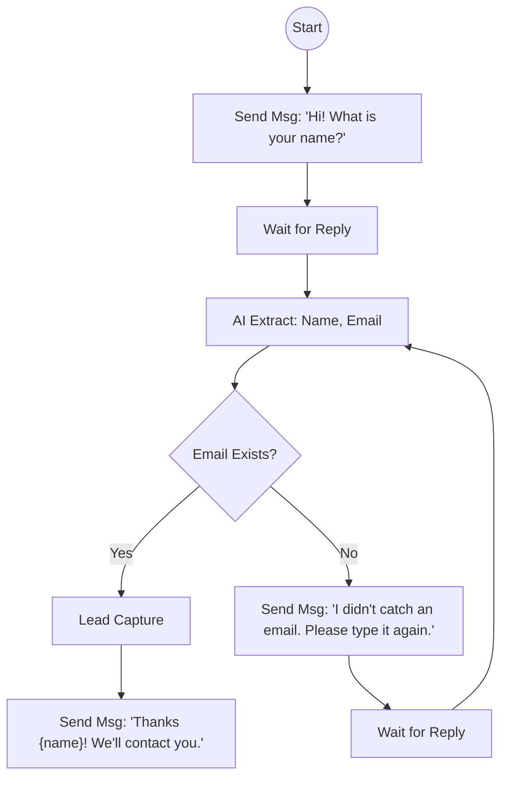
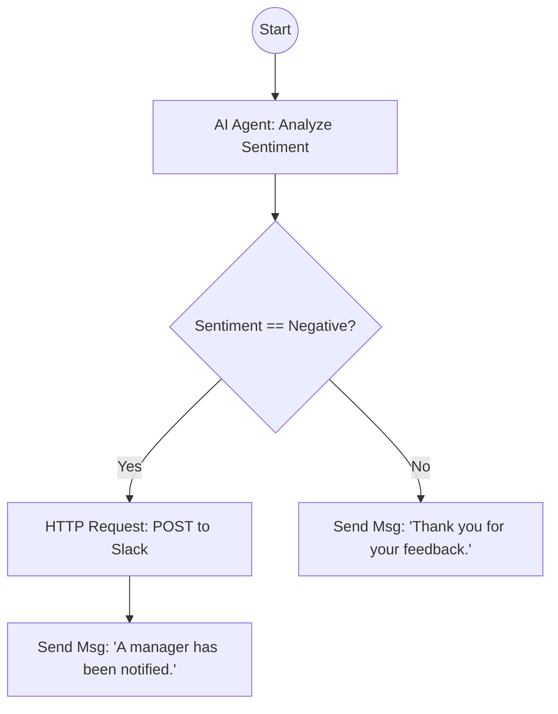
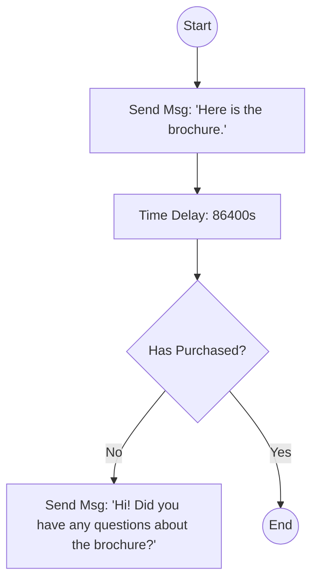

# InteractAI User Manual: Workflow Engine

This manual provides a comprehensive guide to building automated conversational workflows using the InteractAI platform. It covers triggers, node types, and detailed examples for common business use cases.

## 1. Core Concepts

- **Workflow**: A sequence of automated steps triggered by an event.
- **Trigger**: The event that starts a workflow (e.g., incoming message, keyword, manual).
- **Node**: A single step in the workflow (e.g., sending a message, waiting for a reply, AI analysis).
- **Edge**: The connection between notes that defines the flow of execution.
- **Context**: The "memory" of the workflow, storing data like user details, message history, and AI extracted variables.

## 2. Triggers

Triggers determine when a workflow begins execution.

| Trigger Type        | Description                                                   | Configuration                                           |
| :------------------ | :------------------------------------------------------------ | :------------------------------------------------------ |
| **Keyword**         | Starts when a user's message contains specific text.          | `keyword`: The phrase to match (e.g., "help", "price"). |
| **Intent**          | Starts when the AI classifier detects a specific user intent. | `intent`: The detected label (e.g., "booking_inquiry"). |
| **Manual**          | Triggered manually by an admin via the dashboard or API.      | None                                                    |
| **Message Created** | Runs on every incoming message (use with conditions).         | None                                                    |

## 3. Node Reference

### A. Communication Nodes

#### Send Message (`action` / `send_message`)

Sends a text message to the user on their connected channel (WhatsApp, Web, etc.).

- **Config**:
  - `template`: The message text. Supports variable interpolation (e.g., `Hi {contact.name}!`).

#### Wait for Reply (`wait_for_reply`)

Pauses the workflow until the user sends a new message.

- **Config**: None.
- **Behavior**: The workflow enters suspended state. The next user message resumes the workflow from this point, and the message content is available in the context.

### B. Logic & Flow Nodes

#### Condition (`condition`)

Splits the workflow based on data values.

- **Config**:
  - `variable`: The context variable to check (e.g., `ai_extract.email`, `intent`).
  - `operator`: `equals`, `contains`, `greater_than`, `exists`.
  - `value`: The value to compare against.
- **Paths**: Define edges labeled `true` or `false`.

#### Time Delay (`time_delay`)

Pauses execution for a set duration.

- **Config**:
  - `seconds`: Duration to wait (e.g., `3600` for 1 hour).

### C. Intelligence Nodes

#### AI Extract (`ai_extract`)

Uses the LLM to parse structured data from the conversation history.

- **Config**:
  - `fields`: A list of fields to extract (e.g., `[{ "name": "email", "type": "email" }, { "name": "budget", "type": "number" }]`).
- **Output**: Variables are stored in context (e.g., `{email}`) and can be used in conditions or messages.

#### AI Agent (`ai_inference`)

Generates a free-form AI response or decision.

- **Config**:
  - `prompt_template`: Instructions for the AI (e.g., "Answer the user's question about pricing based on our policy.").
- **Output**: Result stored in `ai_output`.

### D. Integration Nodes

#### HTTP Request (`http_request`)

Sends data to an external API (e.g., Zapier, specialized backend).

- **Config**:
  - `url`: The endpoint URL.
  - `method`: `GET` or `POST`.
  - `headers`: JSON object for headers.
  - `body`: JSON payload (supports variables).

#### CRM Actions (`lead_capture`, `create_ticket`)

Interact with the built-in CRM.

- **Lead Capture**: Saves user contact info to the Leads table.
- **Create Ticket**: Opens a support ticket.

## 4. Example Workflows

### Example 1: Lead Capture & Qualification (Stateful)

Goal: Ask for the user's name and email, then save it if valid.



**Steps:**

1. **Trigger**: Keyword "interested".
2. **Send Message**: "Hi! To get started, what is your name and email?"
3. **Wait for Reply**: Workflow suspends.
4. **User Replies**: "My name is Alice and email is alice@example.com".
5. **AI Extract**: Configured to extract name and email. Result: `{"name": "Alice", "email": "alice@example.com"}`.
6. **Condition**: Check if email exists.
   - **True**: Run Lead Capture -> Send "Thanks Alice!".
   - **False**: Send "Could you please provide your email?" -> Loop back to Wait.

### Example 2: External Webhook Integration

Goal: Send high-priority support issues to a Slack channel via Webhook.



**Configuration (HTTP Request Node):**

- **URL**: `https://hooks.slack.com/services/T000/B000/XXXX`
- **Method**: `POST`
- **Body**: `{"text": "Urgent User Feedback: {last_message}"}`

### Example 3: Automated Follow-Up (Time Delay)

Goal: Send a follow-up message 24 hours after an inquiry if no purchase is made.



**Steps:**

1. **Trigger**: User requests brochure.
2. **Action**: Send the brochure link.
3. **Time Delay**: Set seconds to `86400` (24 hours). The workflow pauses execution on the server.
4. **Resume**: After 24h, the engine wakes up the workflow.
5. **Condition**: Check a CRM variable or tag (accessed via HTTP or built-in context).
6. **Action**: Send follow-up nudge.

## 5. Recipes & Integrations

### ⚡ Sending Leads to Google Sheets

You can send captured lead data directly to a Google Sheet using the HTTP Request node and a simple Google Apps Script.

**Step 1: Prepare the Google Sheet**

1. Create a new Google Sheet.
2. Add headers in Row 1: `Name`, `Phone`, `Email`, `Budget`.
3. Go to **Extensions > Apps Script**.
4. Paste the following code:

```javascript
function doPost(e) {
  try {
    const sheet = SpreadsheetApp.getActiveSpreadsheet().getActiveSheet();
    const data = JSON.parse(e.postData.contents);

    // Append row with data from workflow (using ISO timestamp)
    sheet.appendRow([
      new Date().toISOString(),
      data.name || "N/A",
      data.phone || "N/A",
      data.email || "N/A",
      data.budget || "0",
    ]);

    return ContentService.createTextOutput("Success").setMimeType(
      ContentService.MimeType.TEXT
    );
  } catch (err) {
    return ContentService.createTextOutput("Error").setMimeType(
      ContentService.MimeType.TEXT
    );
  }
}
```

5. Click **Deploy > New Deployment**.
6. Select type **Web App**.
7. Set Who has access to **Anyone**.
8. Click **Deploy** and copy the **Web App URL**.

**Step 2: Configure the Workflow**

1. Add an **AI Extract** node to get the fields (e.g., `name`, `budget`).
2. Add an **HTTP Request** node.
   - **Method**: `POST`
   - **URL**: Paste your Google Web App URL.
   - **Headers**: `{"Content-Type": "application/json"}`
   - **Body**:

```json
{
  "name": "{ai_extract.name}",
  "budget": "{ai_extract.budget}",
  "phone": "{user_identifier}"
}
```

## 6. Troubleshooting

- **Workflow not starting?**
  - Check if the Trigger Keyword matches exactly (or check Intent confidence).
  - Ensure the workflow is enabled (`is_active: true`).
- **Variables not replacing?**
  - Ensure you use exact syntax `{variable_name}`.
  - Check `ai_extract` actually found the data by looking at Execution History.
- **"Suspended" state stuck?**
  - The workflow is waiting for a user reply. Send a message as that user to resume.

## 7. Best Practices & System Reliability

To ensure high performance and reliability for your AI automations, the platform implements several advanced features:

- **Isolated Infrastructure**: The database and cache run on dedicated ports (`5435` and `6381`) to prevent interference from other local projects and ensure zero-downtime performance.
- **Persistent Conversations**: The Web Chat widget uses persistent browser storage (`localStorage`) for user IDs. This means conversations are never lost if a user refreshes their page.
- **Real-time Monitoring**: The platform uses an intelligent polling system (every 3 seconds) to fetch background automated replies, ensuring users see workflow responses even if they involve complex AI processing or external API calls.
- **High Concurrency Stability**: The background worker uses an isolated connection pool (`NullPool`) to ensure that sudden spikes in traffic or long-running workflows do not cause database timeouts or connection leaks.
- **Multi-Persona Intelligence**: The system automatically bridges internal identifiers (UUIDs) with external identifiers (Emails), allowing the AI to maintain the correct business persona (e.g., "Copac Group") consistently across all workflows and manual chats.
