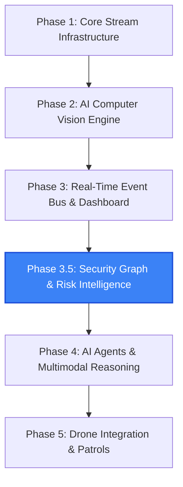

# ARGUS Project Development Roadmap

Welcome to the **ARGUS Security Intelligence Operating System** roadmap. This document outlines the phases of building our state-of-the-art surveillance and security platform, designed to evolve from raw edge camera analytics to a fully autonomous, graph-driven risk intelligence and multi-agent patrol system.

---

## 📋 Development Phases

### 📹 Phase 1: Core Stream Infrastructure
Build the fundamental video capture and RTSP streaming pipeline.
- High-efficiency edge video capturing services.
- Multi-camera stream ingestion and ingestion health metrics.
- Low-latency H.264 stream conversion and browser playback support.

### 🧠 Phase 2: AI Computer Vision Engine
Deploy local deep learning detection and tracking algorithms.
- **YOLOv11 Object Tracking** for real-time person, vehicle, and animal detection.
- **Restricted Zone Intrusion Detection** using point-in-polygon geometry logic.
- **Suspicious Behavior & Loitering Detection** mapping object velocity and dwell time.
- **Fire & Smoke Analytics** based on dedicated convolutional neural networks.
- **Vehicle License Plate Recognition (ALPR)** utilizing OCR tools.

### ⚡ Phase 3: Real-Time Event Bus & Dashboard
Establish real-time communication networks and situational awareness centers.
- Fast API-driven backend with WebSocket real-time event distribution.
- Interactive Web Command Center showing live streams and instant alerts.
- Persisted event storage with historical query APIs.

---

### 🛡️ Phase 3.5: Security Graph & Risk Intelligence
*Status: In Research & Prototyping (Current)*

Establish a centralized intelligence layer to model surveillance observations into relationships and actionable threat risk metrics. This provides the memory and reasoning context required for autonomous security agents.
- **Entity Resolution**: Group repeated observations (e.g., matching license plates, face clusters, or clothing footprints) into unified profiles.
- **Observation Tracking**: Maintain multi-camera event histories linked to single entities.
- **Relationship Modeling**: Connect entities, events, temporal details, and spatial locations in a directed multigraph structure.
- **Risk Engine**: Calculate dynamic risk scores for entities and locations, factoring in event severity and time-decay functions.
- **Intelligence Queries**: Graph-based querying to reveal suspicious traversal paths, loitering-to-intrusion progressions, and risk hotspots.
- **Interactive Security Graph**: Visually interactive UI overlays to inspect relationships, clusters, and node connections.

---

### 🤖 Phase 4: AI Agents & Multimodal Reasoning
*Status: Future*

Deploy autonomous security reasoning.
- Multimodal security agents capable of analyzing images, videos, and graph logs.
- Dynamic natural language query interface for operators to ask complex investigative questions.
- Autonomous alert verification to filter out false alarms (e.g., wind, shadows, stray animals).

### 🛸 Phase 5: Drone Integration & Autonomous Patrols
*Status: Future*

Take actions in the physical world.
- Autonomous dispatch of patrol drones to verify active high-risk zone intrusions.
- Live drone camera stream feed integration with Phase 2 AI engine.
- Flight telemetry reporting and return-to-base automated logic.
